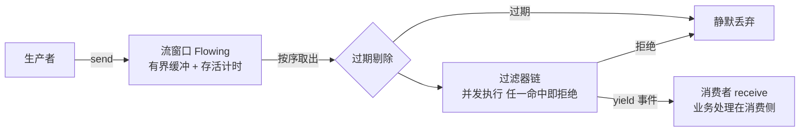

<div align="center">

# Bitongue

基于 anyio 与 msgspec 的异步事件流处理库

[中文] **·** [English](README_en.md)

[](https://github.com/Ahsen17/bitongue/actions/workflows/pytest.yml)
[](LICENSE)
[](pyproject.toml)

</div>

---

## 目录

[简介](#简介) **·** [特性](#特性) **·** [安装](#安装) **·** [快速上手](#快速上手) **·** [架构](#架构) **·** [开发](#开发) **·** [文档](#文档) **·** [贡献](#贡献) **·** [许可证](#许可证)

## 简介

Bitongue - An asynchronous event flowing library.

Bitongue 是一个异步事件流处理库：生产者把事件投入内存流窗口，消费者按序取出通过
过滤器链的事件并自行处理业务。事件为 [msgspec](https://jcristharif.com/msgspec/)
结构体，异步原语来自 [anyio](https://anyio.readthedocs.io/) —— 流窗口负责缓冲与
存活控制，过滤器链负责准入，业务处理留在消费侧，三者可独立演化。

## 特性

- **内存事件流窗口**：基于 anyio 内存流的有界缓冲，窗口容量与事件存活时间可配置，
  过期事件在消费时自动剔除，被拒绝或过期的事件不阻塞后续消费
- **过滤器链准入**：事件进入消费前经过过滤器链，过滤器并发执行、不短路
  （每个过滤器都会看到每个事件），任一过滤器判定命中即拒绝，被拒绝的事件静默丢弃
- **内置过滤器**：关键词黑名单 `KeywordFilter`（Aho-Corasick，归一化匹配，子包
  `bitongue.filter.keyword`）与判重拦截 `SparseTextFilter`（qdrant 稀疏检索，
  语料相似即拒，子包 `bitongue.filter.sparse`）；实现 `FilterLifecycle` 的过滤器
  由编排器统一启动与关闭
- **消费者扩展点**：`receive()` 按序产出通过过滤的事件，业务逻辑在消费侧自由实现，
  事件流转机制与业务处理解耦
- **存活超时保护**：`event_timeout` 控制事件在窗口内的存活时间，过期事件在消费侧
  被静默跳过，不阻塞后续事件
- **类型安全的数据结构**：事件均为 msgspec 结构体，自带字典与 JSON 序列化，
  泛型参数贯穿发送到消费的全流程
- **分层依赖**：核心（流窗口、编排器、关键词过滤器）仅依赖 anyio、msgspec、
  pyahocorasick 等少量包；判重拦截 `SparseTextFilter` 的领域依赖（fastembed、jieba、
  qdrant-client）随可选依赖组 `sparse` 按需安装

## 安装

```bash
# uv
uv add bitongue

# pip
pip install bitongue
```

要求 Python ≥ 3.12。如果该包尚未发布到 PyPI，可以直接从源码安装：

```bash
uv add git+https://github.com/Ahsen17/bitongue.git
```

使用内置判重过滤器 `SparseTextFilter` 时，还需安装可选依赖组 `sparse`
（pip 用户写 `pip install "bitongue[sparse]"`）：

```bash
uv add "bitongue[sparse]"
```

## 快速上手

定义一个过滤器（拒绝空文本），发送两条事件并消费通过的事件（业务处理在消费侧完成）：

```python
from uuid import uuid4

import anyio

from bitongue.client import Bitongue, BitongueConfig
from bitongue.flow import Event


class TextEvent(Event):
    """业务事件：身份 + 文本载荷。"""

    type: str = "text"
    text: str = ""


class EmptyTextFilter:
    """过滤器：空文本事件判定命中（返回 True 即拒绝）。"""

    async def filter(self, event: TextEvent) -> bool:
        return not event.text


async def main() -> None:
    config = BitongueConfig(
        buffer_size=16,     # 流窗口容量（有界缓冲大小）
        event_timeout=30,   # 事件在窗口内的存活秒数
    )
    client = Bitongue(config, EmptyTextFilter())
    await client.start()

    async def consume() -> None:
        async for event in client.receive():
            print(event.text.upper())  # 业务处理：转大写
            break  # 示例到此结束；真实场景可按需持续消费

    async with anyio.create_task_group() as tg:
        tg.start_soon(consume)
        # id 由业务侧生成后透传；真实场景通常用业务系统已有的标识
        await client.send(TextEvent(id=uuid4(), text="hello bitongue"))
        await client.send(TextEvent(id=uuid4(), text=""))  # 会被过滤器拒绝

    await client.close()


if __name__ == "__main__":
    anyio.run(main)
```

运行输出：

```text
HELLO BITONGUE
```

逐步讲解见文档站的[快速上手](https://ahsen17.github.io/bitongue/guide/quickstart.html)。

## 架构



- **生产侧**：`Bitongue.send()` 把事件包装成条目（记录入库时刻与存活时间）投入
  有界缓冲；窗口满时发送方等待，形成背压。
- **消费侧**：`Bitongue.receive()` 按序取出条目，先剔除入库后超过存活时间的过期事件；
  过滤器并发执行且不短路，任一命中即拒绝该事件，通过的事件逐条产出。
  过滤器异常汇总为一个 `ExceptionGroup` 上抛，终止事件流。

完整结构与一条事件的生命周期见[架构与数据流](https://ahsen17.github.io/bitongue/guide/architecture.html)。

## 开发

```bash
make install    # 初始化虚拟环境并安装依赖
make check      # lint + 类型检查 + 全部测试
make coverage   # 覆盖率报告（fail_under = 80）
make docs-build # 构建双语文档站
```

提交信息遵循 [Conventional Commits](https://www.conventionalcommits.org/zh-hans/)，
详见 [CONTRIBUTING.md](CONTRIBUTING.md)。

## 文档

完整的双语文档站点（快速上手、核心概念、架构与数据流、配置说明）：

- 简体中文：<https://ahsen17.github.io/bitongue/>
- English: <https://ahsen17.github.io/bitongue/en/>

## 贡献

欢迎通过 issue 反馈问题、通过 PR 提交改动。本项目接受 AI 辅助编程贡献，
但贡献者需对提交的代码负全责 —— 详见[贡献指南](CONTRIBUTING.md)。

## 许可证

[AGPL-3.0](LICENSE)
