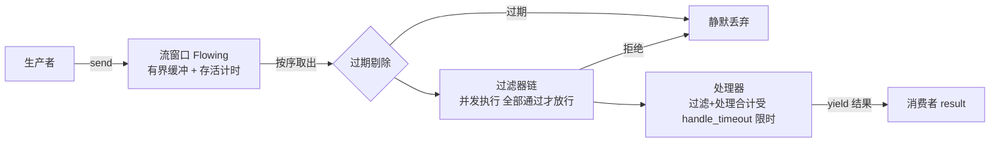

<div align="center">

# Bitongue

基于 anyio 与 msgspec 的异步消息流处理库

[中文] **·** [English](README_en.md)

[](https://github.com/Ahsen17/bitongue/actions/workflows/pytest.yml)
[](LICENSE)
[](pyproject.toml)

</div>

---

## 目录

[简介](#简介) **·** [特性](#特性) **·** [安装](#安装) **·** [快速上手](#快速上手) **·** [架构](#架构) **·** [开发](#开发) **·** [文档](#文档) **·** [贡献](#贡献) **·** [许可证](#许可证)

## 简介

Bitongue - A message flowing noting library.

Bitongue 是一个异步消息流处理库：生产者把消息投入内存流窗口，消费者按序取出、
过滤后交给处理器，产出结果。消息与结果均为 [msgspec](https://jcristharif.com/msgspec/)
结构体，异步原语来自 [anyio](https://anyio.readthedocs.io/) —— 流窗口负责缓冲与
存活控制，过滤器链负责准入，处理器负责业务逻辑，三者可独立演化。

## 特性

- **内存消息流窗口**：基于 anyio 内存流的有界缓冲，窗口容量与消息存活时间可配置，
  过期消息在消费时自动剔除，被拒绝或过期的消息不阻塞后续消费
- **过滤器链准入**：消息进入处理前经过过滤器链，过滤器并发执行、全部通过才放行，
  被拒绝的消息静默丢弃
- **内置过滤器**：关键词黑名单 `KeywordsFilter`（Aho-Corasick，归一化匹配）、
  判重拦截 `SparseFilter`（qdrant 稀疏检索，语料相似即拒）与模型判定
  `NeuroFilter`（大语言模型按自然语言规则裁决）；
  实现 `FilterLifecycle` 的过滤器由编排器统一启动与关闭
- **处理器扩展点**：实现一个异步 `handle(message) -> result` 方法即可接入业务逻辑，
  消息流转机制与业务处理解耦
- **双层超时保护**：流窗口超时控制消息存活，处理超时限制单条消息过滤与处理的合计耗时
  （超时会真正取消执行中的工作），超时消息被跳过而不阻塞后续消息
- **类型安全的数据结构**：消息与结果均为 msgspec 结构体，自带字典与 JSON 序列化，
  泛型参数贯穿发送到结果的全流程
- **分层依赖**：核心（流窗口、编排器、关键词过滤器）仅依赖 anyio、msgspec、
  pyahocorasick 等少量包；判重拦截 `SparseFilter` 的领域依赖（fastembed、jieba、
  qdrant-client）随可选依赖组 `sparse` 按需安装；模型判定 `NeuroFilter` 的
  领域依赖（autogen）随可选依赖组 `neuro` 按需安装

## 安装

```bash
# uv
uv add bitongue

# pip
pip install bitongue
```

要求 Python ≥ 3.12。如果该包尚未发布到 PyPI，可以直接从源码安装：

```bash
uv add git+https://github.com/Ahsen17/bitongue.git
```

使用内置判重过滤器 `SparseFilter` 时，还需安装可选依赖组 `sparse`
（pip 用户写 `pip install "bitongue[sparse]"`）：

```bash
uv add "bitongue[sparse]"
```

使用内置模型判定过滤器 `NeuroFilter` 时，还需安装可选依赖组 `neuro`
（pip 用户写 `pip install "bitongue[neuro]"`）：

```bash
uv add "bitongue[neuro]"
```

## 快速上手

定义一个过滤器（丢弃空文本）和一个处理器（转大写），发送两条消息并消费结果：

```python
from uuid import uuid4

import anyio

from bitongue.client import Bitongue, BitongueConfig
from bitongue.filter import BaseFilter
from bitongue.flow import BaseMessage
from bitongue.handler import BaseHandler, BaseResult


class UpperResult(BaseResult):
    """处理结果：大写文本。"""

    text: str


class NonEmptyFilter(BaseFilter[BaseMessage]):
    """过滤器：丢弃空文本消息。"""

    async def filter(self, message: BaseMessage) -> bool:
        return bool(message.text)


class UpperHandler(BaseHandler[BaseMessage, UpperResult]):
    """处理器：把文本转成大写。"""

    async def handle(self, message: BaseMessage) -> UpperResult:
        return UpperResult(id=message.id, text=(message.text or "").upper())


async def main() -> None:
    config = BitongueConfig(
        flowing_size=16,       # 流窗口容量（有界缓冲大小）
        flowing_timeout=30,    # 消息在窗口内的存活秒数
        handle_timeout=5.0,    # 单条消息过滤+处理的超时秒数
    )
    client = Bitongue(config, handler=UpperHandler(), filters=[NonEmptyFilter()])

    await client.start()
    # id 由业务侧生成后透传；真实场景通常用业务系统已有的标识
    await client.send(BaseMessage(id=uuid4(), type="text", text="hello bitongue"))
    await client.send(BaseMessage(id=uuid4(), type="text", text=""))  # 会被过滤器丢弃

    async for result in client.result():
        print(result.text)  # HELLO BITONGUE
        break  # 示例到此结束；真实场景可按需持续消费

    await client.shutdown()


if __name__ == "__main__":
    anyio.run(main)
```

运行输出：

```text
HELLO BITONGUE
```

逐步讲解见文档站的[快速上手](https://ahsen17.github.io/bitongue/guide/quickstart.html)。

## 架构



- **生产侧**：`Bitongue.send()` 把消息包装成条目（记录入库时刻与存活时间）投入
  有界缓冲；窗口满时发送方等待，形成背压。
- **消费侧**：`Bitongue.result()` 按序取出条目，先剔除入库后超过存活时间的过期消息；
  过滤器并发执行，全部通过的消息交给处理器，过滤与处理合计受 `handle_timeout` 约束，
  超时消息被跳过。失败按故障作用域分级：处理器异常包装为 `MessageHandleError` 后转为
  `MessageHandleFailure` 信封按序产出，流不中断；过滤器异常汇总为 `ExceptionGroup`
  上抛，终止结果流。

完整结构与一条消息的生命周期见[架构与数据流](https://ahsen17.github.io/bitongue/guide/architecture.html)。

## 开发

```bash
make install    # 初始化虚拟环境并安装依赖
make check      # lint + 类型检查 + 全部测试
make coverage   # 覆盖率报告（fail_under = 80）
make docs-build # 构建双语文档站
```

提交信息遵循 [Conventional Commits](https://www.conventionalcommits.org/zh-hans/)，
详见 [CONTRIBUTING.md](CONTRIBUTING.md)。

## 文档

完整的双语文档站点（快速上手、核心概念、架构与数据流、配置说明）：

- 简体中文：<https://ahsen17.github.io/bitongue/>
- English: <https://ahsen17.github.io/bitongue/en/>

## 贡献

欢迎通过 issue 反馈问题、通过 PR 提交改动。本项目接受 AI 辅助编程贡献，
但贡献者需对提交的代码负全责 —— 详见[贡献指南](CONTRIBUTING.md)。

## 许可证

[AGPL-3.0](LICENSE)
