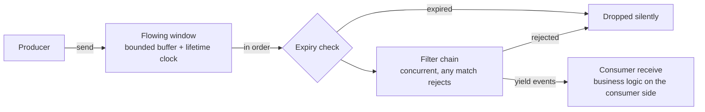

<div align="center">

# Bitongue

An async event flowing library built on anyio and msgspec

[中文](README.md) **·** [English]

[](https://github.com/Ahsen17/bitongue/actions/workflows/pytest.yml)
[](LICENSE)
[](pyproject.toml)

</div>

---

## Contents

[About](#about) **·** [Features](#features) **·** [Installation](#installation) **·** [Quick start](#quick-start) **·** [Architecture](#architecture) **·** [Development](#development) **·** [Documentation](#documentation) **·** [Contributing](#contributing) **·** [License](#license)

## About

Bitongue - An asynchronous event flowing library.

Bitongue is an async event flowing library: producers put events into an in-memory flowing window; consumers draw the events that passed the filter chain in order and handle the business logic on their side. Events are [msgspec](https://jcristharif.com/msgspec/) structs and the async primitives come from [anyio](https://anyio.readthedocs.io/) — the flowing window owns buffering and lifetime control, the filter chain owns admission, and business logic stays on the consumer side, each evolving independently.

## Features

- **In-memory event flowing window**: a bounded buffer built on anyio memory streams, with a configurable window size and event lifetime; expired events are dropped automatically at consumption time, and rejected or expired events never block the rest
- **Filter-chain admission**: events pass through the filter chain before consumption; filters run concurrently without short-circuiting (every filter sees every event), and a single matching verdict rejects the event, which is then dropped silently
- **Built-in filters**: the keyword blocklist `KeywordFilter` (Aho-Corasick with normalized matching, subpackage `bitongue.filter.keyword`) and duplicate interception via `SparseTextFilter` (qdrant sparse retrieval — similar to the corpus means rejected, subpackage `bitongue.filter.sparse`); filters implementing `FilterLifecycle` are started and stopped by the orchestrator
- **Consumer extension point**: `receive()` yields the events that passed filtering in order, so business logic stays on the consumer side, keeping flow mechanics decoupled from event processing
- **Lifetime timeout protection**: `event_timeout` bounds how long an event stays alive in the window; expired events are skipped silently on the consumer side without blocking the rest
- **Type-safe data structures**: events are msgspec structs with built-in dict and JSON serialization, and generic parameters flow through from send to consumption
- **Layered dependencies**: the core (flowing window, orchestrator, keyword filter) depends only on a few packages such as anyio, msgspec, and pyahocorasick; the domain dependencies of duplicate interception via `SparseTextFilter` (fastembed, jieba, qdrant-client) ship as the optional `sparse` extra

## Installation

```bash
# uv
uv add bitongue

# pip
pip install bitongue
```

Python ≥ 3.12 is required. If the package is not yet published to PyPI, install it from source:

```bash
uv add git+https://github.com/Ahsen17/bitongue.git
```

Using the built-in duplicate-interception filter `SparseTextFilter` additionally
requires the optional `sparse` extra (pip users write
`pip install "bitongue[sparse]"`):

```bash
uv add "bitongue[sparse]"
```

## Quick start

Define a filter (rejects empty text), send two events, and consume the ones that passed (business logic lives on the consumer side):

```python
from uuid import uuid4

import anyio

from bitongue.client import Bitongue, BitongueConfig
from bitongue.flow import Event


class TextEvent(Event):
    """A business event: identity plus a text payload."""

    type: str = "text"
    text: str = ""


class EmptyTextFilter:
    """A filter that flags empty text (returning True rejects the event)."""

    async def filter(self, event: TextEvent) -> bool:
        return not event.text


async def main() -> None:
    config = BitongueConfig(
        buffer_size=16,    # flowing window capacity (bounded buffer size)
        event_timeout=30,  # seconds an event stays alive in the window
    )
    client = Bitongue(config, EmptyTextFilter())
    await client.start()

    async def consume() -> None:
        async for event in client.receive():
            print(event.text.upper())  # business logic: uppercase the text
            break  # the demo ends here; keep consuming as needed in real usage

    async with anyio.create_task_group() as tg:
        tg.start_soon(consume)
        # The id is generated on the business side and passed through; real
        # applications typically reuse an identifier they already have.
        await client.send(TextEvent(id=uuid4(), text="hello bitongue"))
        await client.send(TextEvent(id=uuid4(), text=""))  # rejected by the filter

    await client.close()


if __name__ == "__main__":
    anyio.run(main)
```

Output:

```text
HELLO BITONGUE
```

For a step-by-step walkthrough, see [Quick start](https://ahsen17.github.io/bitongue/en/guide/quickstart.html) in the documentation site.

## Architecture



- **Production side**: `Bitongue.send()` wraps an event into an entry (recording its entry time and lifetime) and puts it into the bounded buffer; when the window is full the sender waits, creating backpressure.
- **Consumption side**: `Bitongue.receive()` draws entries in order and first drops those past their lifetime; filters run concurrently without short-circuiting, and a single matching verdict rejects the event, while the survivors are yielded one by one. Filter exceptions are collected into one `ExceptionGroup` that terminates the event stream.

For the full structure and the life of an event, see [Architecture and data flow](https://ahsen17.github.io/bitongue/en/guide/architecture.html).

## Development

```bash
make install     # initialize the virtual environment and install dependencies
make check       # lint + type checks + all tests
make coverage    # coverage report (fail_under = 80)
make docs-build  # build the bilingual documentation site
```

Commit messages follow [Conventional Commits](https://www.conventionalcommits.org/en/); see [CONTRIBUTING_en.md](CONTRIBUTING_en.md) for details.

## Documentation

The full bilingual documentation site (quick start, core concepts, architecture, configuration):

- 简体中文: <https://ahsen17.github.io/bitongue/>
- English: <https://ahsen17.github.io/bitongue/en/>

## Contributing

Issues are welcome for bug reports and feature requests, and pull requests for changes. AI-assisted coding contributions are accepted, but contributors are fully responsible for the code they submit — see the [contributing guide](CONTRIBUTING_en.md).

## License

[AGPL-3.0](LICENSE)
